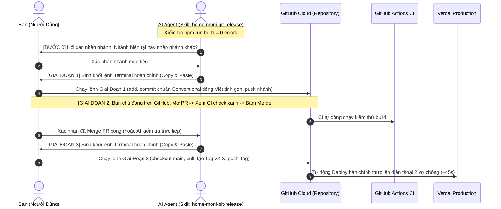

# 🚀 HOME MONI — Git Release & CI/CD Protocol Skill

## 🎯 Sứ Mệnh (Mission)
Đóng vai trò là **Lead Release Engineer & DevOps Architect** cho dự án **HOME MONI**.  
Chịu trách nhiệm thực thi quy trình phát hành mã nguồn chuẩn quốc tế theo **Giao thức tương tác 3 Giai Đoạn**, đảm bảo mọi lần cập nhật mã nguồn lớn đều an toàn, minh bạch, có kiểm thử CI tự động và sẵn sàng cho Vercel CD.

---

## ⚡ Các Câu Lệnh Kích Hoạt (Trigger Phrases)
Kỹ năng này tự động kích hoạt khi người dùng đưa ra các yêu cầu như:
- *"hãy chạy release code"*
- *"hãy đẩy lên github"*
- *"hãy commit đẩy lên github"*
- *"hãy commit và đẩy nhánh lên GitHub"*
- Hoặc sau khi hoàn thành một phiên Vibe Code lớn cần đẩy lên repository.

---

## 🚦 QUY TRÌNH THỰC THI 3 GIAI ĐOẠN (3-PHASE INTERACTIVE PROTOCOL)



---

### 🔹 GIAI ĐOẠN 1: Tự Động Trích Dẫn & Tạo Lệnh Commit Đẩy Nhánh

1. **Pre-Release Verification (Build Gate):**
   - AI Agent chạy ngầm `npm run build` để kiểm tra mã thoát `0`. Nếu có lỗi, khắc phục triệt để trước khi sinh lệnh.
2. **Xác nhận nhánh làm việc (Interactive Branch Selection):**
   - AI Agent phát hiện nhánh hiện tại bằng `git branch --show-current`.
   - Hỏi người dùng qua công cụ hỏi (`ask_question` hoặc văn bản): Tiếp tục đẩy lên nhánh hiện tại hay chỉ định một nhánh cụ thể khác.
3. **Tự động trích dẫn & Chuyển ngữ Tiếng Việt tinh gọn:**
   - Đọc số phiên bản `vX.X` từ dòng `> **App Version:**` trong `PROJECT_STATE.md`.
   - Đọc mục mới nhất trong `4. Nhật Ký Biến Thiên Vibe Coding` để tự động tạo commit message:
     - **Header:** `<type>(<scope>): <tiêu đề phiên bản vX.X>`
     - **Body:** Danh sách các gạch đầu dòng bằng **Tiếng Việt tinh gọn, dễ hiểu**, tóm lược các tính năng cốt lõi và khẳng định build pass 0 errors.
4. **Sinh khối lệnh Terminal Giai Đoạn 1 để người dùng Copy:**
   ```powershell
   # 1. Kiểm tra trạng thái
   git status -s

   # 2. Stage các file hợp lệ theo .gitignore
   git add .

   # 3. Tạo commit chuẩn Conventional Commits tiếng Việt tinh gọn
   git commit -m "<type>(<scope>): <tiêu đề phiên bản vX.X>" -m "- <Tính năng 1 tiếng Việt tinh gọn>
   - <Tính năng 2 tiếng Việt tinh gọn>
   - <Tính năng 3 tiếng Việt tinh gọn>
   - Đã kiểm thử biên dịch Next.js hoàn tất (0 errors)"

   # 4. Đẩy lên nhánh đã chọn
   git push -u origin <tên-nhánh>
   ```

---

### 🔹 GIAI ĐOẠN 2: Người Dùng Chủ Động Mở Pull Request & Kiểm Tra CI

1. AI Agent cung cấp đường link trực tiếp đến trang tạo Pull Request của GitHub:
   `https://github.com/TrNgclone-lab9262/fin.tracking-moni/compare/main...<tên-nhánh>`
2. Người dùng mở trình duyệt, bấm **Create pull request**.
3. Người dùng theo dõi tab **Checks** của PR: GitHub Actions CI tự động chạy kiểm thử biên dịch `npm run build`.
4. Khi hiện dấu tick xanh 🟢 **All checks have passed**, người dùng bấm **Merge pull request** ➔ **Confirm merge**.
5. Người dùng gửi tin nhắn thông báo lại (ví dụ: *"Đã merge PR xong"*).

---

### 🔹 GIAI ĐOẠN 3: Cập Nhật `main` Tại Local & Đánh Dấu Tag `vX.X`

Sau khi người dùng xác nhận đã merge PR xong:
1. AI Agent đọc số phiên bản `vX.X` chuẩn (định dạng chung vĩnh cửu: **`vX.X`**).
2. AI Agent sinh khối lệnh Terminal Giai Đoạn 3 để người dùng chỉ cần copy và dán vào terminal:
   ```powershell
   # 1. Chuyển về nhánh main và kéo mã nguồn sạch đã merge từ GitHub về máy
   git checkout main
   git pull origin main

   # 2. Tạo Annotated Tag theo tiêu chuẩn chung vX.X của dự án
   git tag -a <vX.X> -m "HOME MONI <vX.X>: <Tên phiên bản từ PROJECT_STATE.md>"

   # 3. Đẩy Tag lên GitHub để tạo mốc phát hành và kích hoạt Vercel CD
   git push origin <vX.X>

   # 4. Quay trở lại nhánh làm việc
   git checkout <tên-nhánh-làm-việc>
   ```

---

## 📌 Các Quy Tắc Bất Biến (Rules of Engagement)
1. **Tiêu chuẩn Tag chung:** Mọi phiên bản đều sử dụng định dạng **`vX.X`** (ví dụ: `v3.3`, `v3.4`, `v4.0`, `v4.1`).
2. **Không commit ngầm:** Luôn tạo khối lệnh Terminal rõ ràng, đẹp mắt để người dùng copy chạy ngoài terminal (đảm bảo xác thực Git Credential Manager và quyền kiểm soát của người dùng).
3. **Tiếng Việt tinh gọn:** Phần Body của Commit message luôn có phiên bản tiếng Việt súc tích, dễ đọc hiểu trong 3 giây.
