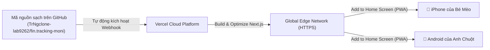

# 🌐 TIÊU CHUẨN & HƯỚNG DẪN TRIỂN KHAI CD LÊN VERCEL
> Áp dụng cho: Đưa ứng dụng **HOME MONI** lên đám mây Vercel để 2 vợ chồng (Anh Chuột & Bé Mèo) dùng trên điện thoại.

---

## 1. Tổng Quan Kiến Trúc Triển Khai (CD Pipeline)

- **Môi trường:** Vercel Hobby (Hoàn toàn miễn phí, hỗ trợ băng thông cao, bảo mật SSL/HTTPS tự động).
- **Framework Preset:** Next.js (Tự động nhận diện 100%).
- **Continuous Deployment:** Mỗi lần `git push origin main` thành công, Vercel tự động build và deploy bản mới chỉ sau ~45 giây.

---

## 2. Các Bước Triển Khai Thực Tế Lần Đầu Tiên

### Bước 1: Đăng nhập Vercel bằng GitHub
1. Truy cập [vercel.com](https://vercel.com) và chọn **Sign Up / Log In**.
2. Chọn **Continue with GitHub** và đăng nhập bằng tài khoản **`TrNgclone-lab9262`**.

### Bước 2: Import Repository
1. Trên bảng điều khiển Vercel Dashboard, bấm nút **"Add New..."** ➔ Chọn **"Project"**.
2. Tìm kiếm repository: **`fin.tracking-moni`** trong danh sách và bấm **Import**.

### Bước 3: Cấu hình Dự án & Biến môi trường (Environment Variables)
1. **Project Name:** Giữ mặc định `fin-tracking-moni` hoặc đổi thành `home-moni`.
2. **Framework Preset:** Đảm bảo hiển thị `Next.js`.
3. **Root Directory:** `./` (mặc định).
4. **Environment Variables (BẮT BUỘC):**
   Mở phần **Environment Variables** và nhập 2 biến từ file `.env.local`:
   - `NEXT_PUBLIC_SUPABASE_URL`: `https://[mã-dự-án].supabase.co`
   - `NEXT_PUBLIC_SUPABASE_ANON_KEY`: `eyJhbGciOi...`
5. Bấm nút **"Deploy"**.

---

## 3. Hướng Dẫn Cài Đặt Lên Màn Hình Điện Thoại (PWA Installation)

Vì **HOME MONI** đã có sẵn cấu hình [`public/manifest.json`](file:///d:/NTT-2026/dev.app/fi.tracking-moni/public/manifest.json) chuẩn Progressive Web App (PWA):

### Dành cho Bé Mèo (iPhone / iPad - Safari):
1. Mở đường link Vercel của dự án (ví dụ: `https://home-moni.vercel.app`) trên trình duyệt **Safari**.
2. Bấm vào biểu tượng **Chia sẻ (Share)** ở thanh công cụ dưới cùng (hình vuông có mũi tên chỉ lên).
3. Cuộn xuống và chọn **"Thêm vào Màn hình chính" (Add to Home Screen)**.
4. Đặt tên là **HOME MONI** và bấm **Thêm (Add)**.
5. Ứng dụng sẽ xuất hiện ngoài màn hình chính với icon ngôi nhà trái tim, khi mở sẽ chạy toàn màn hình không có thanh địa chỉ trình duyệt như một App native!

### Dành cho Anh Chuột (Android - Chrome):
1. Mở link trên trình duyệt **Google Chrome**.
2. Bấm vào biểu tượng **Menu (3 dấu chấm)** góc trên cùng bên phải.
3. Chọn **"Cài đặt ứng dụng" (Install app)** hoặc **"Thêm vào Màn hình chính"**.
4. Xác nhận cài đặt.

---

## 4. Kiểm Soát & Bảo Trì Môi Trường Production
- **Preview Deployments:** Khi tạo nhánh tính năng mới (`feat/...`) và mở Pull Request, Vercel sẽ tự động tạo một đường link xem trước (Preview URL) riêng biệt để bạn kiểm tra thử trước khi gộp vào `main`.
- **Instant Rollback:** Nếu phiên bản mới có vấn đề, bạn có thể vào tab **Deployments** trên Vercel và bấm **Rollback** về bản trước đó chỉ trong 3 giây.
