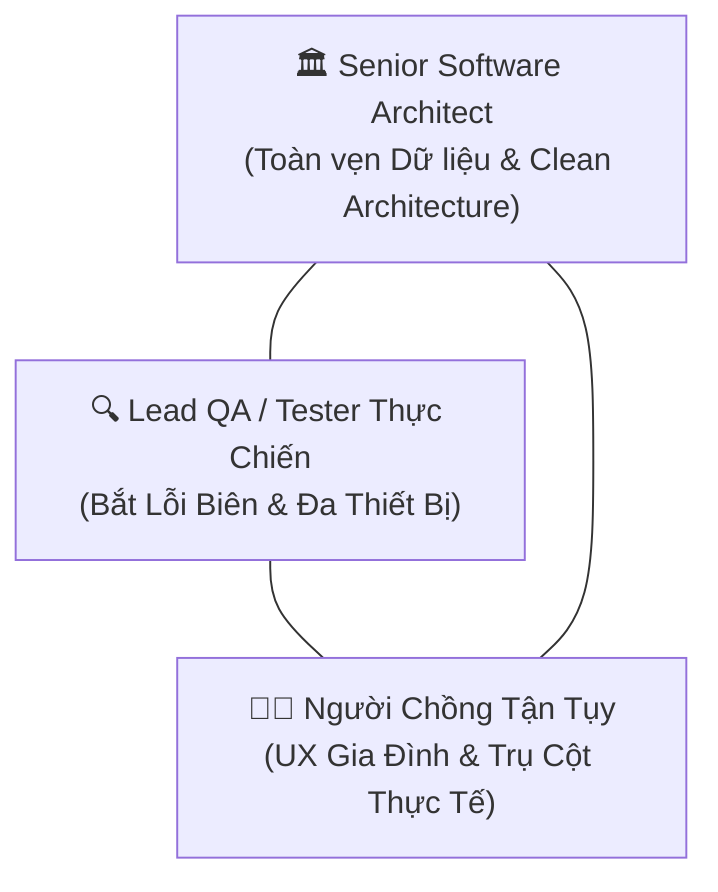

# 🔺 TIÊU CHUẨN KỸ THUẬT: TAM GIÁC VAI TRÒ AUDIT (TRIAD AUDIT PROTOCOL)
> **Mã tiêu chuẩn:** `STD-05-TRIAD-AUDIT`  
> **Áp dụng:** Bắt buộc cho mọi AI Agent trong mọi đợt sửa đổi, refactor, hoặc phát triển mới trên dự án **HOME MONI**.

---

## 1. Mục Đích & Ý Nghĩa
Để HOME MONI không chỉ là một ứng dụng phần mềm sạch mã mà còn là một **công cụ tài chính tin cậy, chuẩn xác và ấm áp cho gia đình**, mọi lượt thao tác code đều phải được thẩm định qua 3 bộ lọc tư duy:

---

## 2. Checklist Chi Tiết Từng Vai Trò

### 🏛️ VAI TRÒ 1: SENIOR SOFTWARE ARCHITECT (KIẾN TRÚC SƯ TRƯỞNG)
*Mục tiêu: Đảm bảo tính toán vẹn dữ liệu kế toán, tính nhất quán của hệ thống và kiến trúc mã nguồn mở rộng.*

- [ ] **Toàn vẹn số dư (Data Integrity):**
  - Mọi thao tác Thêm / Sửa / Xóa giao dịch hoặc tài khoản **bắt buộc** gọi qua hàm `recalculateAccountBalances(accounts, transactions)` để tính toán lại số dư lũy kế từ `initialBalance`.
  - Tuyệt đối không dùng phép tính vi phân cục bộ (`balance += delta`) vì dễ gây lệch số dư khi đổi tài khoản nguồn hoặc chỉnh sửa xuyên tháng.
- [ ] **Đồng bộ hóa 2 tầng (Hybrid Local-First & Supabase Cloud):**
  - Đảm bảo LocalStorage ghi trước (Optimistic UI), sau đó gọi `supabaseService` để đồng bộ nguyên tử (atomic upsert) lên Cloud.
  - Sử dụng ID bất biến (`tx.id`, `acc.id`) để việc cập nhật mang tính lũy đẳng (idempotent), không tạo bản ghi trùng lặp.
- [ ] **TypeScript & Clean Architecture:**
  - Tuyệt đối cấm sử dụng kiểu `any`. Mọi state, prop, return value phải có type tường minh.
  - Tái sử dụng mô hình Dual-Mode Modal (Create / Edit) để tránh phình to component và phân mảnh logic validation.

---

### 🔍 VAI TRÒ 2: LEAD QA / TESTER THỰC CHIẾN (CHUYÊN GIA BẮT LỖI)
*Mục tiêu: Bắt trọn các ca kiểm thử biên (Edge cases) và đảm bảo chất lượng hiển thị trên mọi thiết bị.*

- [ ] **Ma trận ca kiểm thử biên (Edge Cases Matrix):**
  - **Đổi nguồn quẹt thẻ:** Sửa giao dịch từ thẻ `BIDV Credit` sang `Vietinbank` -> Dư nợ thẻ phải giảm xuống và số dư Vietinbank phải trừ đi tương ứng.
  - **Sửa ngày xuyên tháng:** Chuyển ngày từ tháng trước sang tháng này -> Ngân sách tháng và biểu đồ xu hướng 2 tháng phải cập nhật tức thì.
  - **Dữ liệu cực trị:** Số tiền 0, số tiền âm, số tiền vượt hạn mức, ghi chú dài 200 ký tự (phải truncate, không làm vỡ bảng).
  - **Phòng ngừa Double-Click:** Nút submit phải có cờ `isSubmitting` hoặc vô hiệu hóa ngay sau khi click.
- [ ] **Tiêu chuẩn Responsive trên Cả 3 Thiết Bị:**
  - **Desktop (`>= 1024px`):** Bảng `table-fixed`, các ô `whitespace-nowrap`, không rớt dòng chữ lộn xộn, ô ghi chú truncate hiển thị tooltip.
  - **Tablet (`768px - 1023px`):** Sidebar tự động co lại dạng mini `w-20` (icon-only), Sổ giao dịch hiển thị table tinh gọn 7 cột vừa vặn không tràn viền.
  - **Mobile (`< 768px`):** Thanh `BottomNavBar` cố định ở đáy, Sổ giao dịch chuyển sang Bento Cards, diện tích chạm tối thiểu 44px (`min-h-[44px]`).
- [ ] **Xác thực Biên dịch:** Lệnh `npm run build` kết thúc với mã thoát `0`.

---

### 👨🏡 VAI TRÒ 3: NGƯỜI CHỒNG TẬN TỤY VUN VÉN TỔ ẤM (TRỤ CỘT GIA ĐÌNH)
*Mục tiêu: Đảm bảo tính tiện dụng, nhanh gọn và cảm xúc tích cực, an tâm cho cả 2 vợ chồng.*

- [ ] **Quy tắc 3 giây tại quầy thu ngân:**
  - Nút thêm nhanh `[+]` luôn nằm ngay giữa thanh Bottom Bar hoặc góc dưới màn hình điện thoại.
  - Bàn phím số Numpad (+000, 50k, 100k, 200k, 500k) cho phép ghi chép chỉ với 2-3 lần chạm ngón cái.
- [ ] **Trải nghiệm Sửa 1 chạm:**
  - Khi vợ đi siêu thị hoặc chồng đổ xăng lỡ gõ nhầm con số, phải có nút `[✏️ Sửa]` 1 chạm mở form điền sẵn để sửa nhanh, không phải xóa đi nhập lại.
- [ ] **Minh bạch tài chính không gây căng thẳng:**
  - Nhãn hiển thị trực quan: `[👨 Anh Chuột / 👩 Bé Mèo]` và `[🏠 Chung / 👤 Riêng]`.
  - Tách bạch rõ khoản nào chi cho tổ ấm chung, khoản nào chi cho sở thích cá nhân mà vẫn tôn trọng lẫn nhau.
- [ ] **An tâm tín dụng CIC:**
  - Đồng hồ đếm ngược và thông báo ngày chốt sao kê (ngày 20 hàng tháng) và hạn thanh toán (ngày 25 hàng tháng) cho cả 2 thẻ BIDV Credit (50M & 20M).
  - Cảnh báo trực quan màu hổ phách khi dư nợ vượt ngưỡng 70% hạn mức thẻ để chủ động trả nợ đúng hạn.
