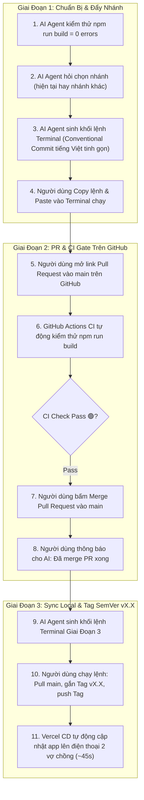

# 🚀 TIÊU CHUẨN PHÁT HÀNH MÃ NGUỒN & CI/CD PROTOCOL (HOME MONI)
> Áp dụng cho: Mọi phiên phát hành mã nguồn, đẩy code lên GitHub, kích hoạt kiểm thử CI và triển khai CD Vercel cho dự án **HOME MONI**.

---

## 1. Giao Thức Tương Tác 3 Giai Đoạn (3-Phase Release Protocol)

Để bảo đảm tính an toàn, linh hoạt tuyệt đối và quyền kiểm soát của người dùng, mọi lần phát hành mã nguồn đều tuân theo 3 giai đoạn:

---

## 2. Tiêu Chuẩn Tag Phiên Bản Thống Nhất (`vX.X`)

- Toàn bộ các mốc phát hành của dự án HOME MONI đều thống nhất sử dụng định dạng Tag: **`vX.X`** (ví dụ: `v3.3`, `v3.4`, `v4.0`, `v4.1`).
- Tag bắt buộc phải là **Annotated Tag** (có cờ `-a` và chú thích `-m` tóm tắt tên phiên bản).
- Khi đẩy Tag lên GitHub bằng `git push origin vX.X`, GitHub sẽ lưu lại một Snapshot lịch sử vĩnh viễn và Vercel có thể nhận diện phiên bản phát hành chính thức.

---

## 3. Câu Lệnh Kích Hoạt Kỹ Năng (Trigger Phrases)
Khi người dùng đưa ra các câu lệnh sau, AI Agent sẽ tự động nạp Skill `home-moni-git-release` và kích hoạt quy trình 3 giai đoạn:
1. *"hãy chạy release code"*
2. *"hãy đẩy lên github"*
3. *"hãy commit đẩy lên github"*
4. *"hãy commit và đẩy nhánh lên GitHub"*
