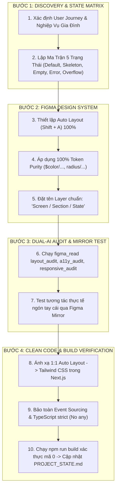

# 📐 TIÊU CHUẨN THỰC THI "VIBE LOOP" CHUẨN SENIOR UX/UI WEBAPP (HOME MONI)
> Áp dụng cho: Mọi lượt nghiên cứu, thiết kế, sửa đổi hoặc thêm mới tính năng giao diện người dùng (UI/UX) cho dự án **HOME MONI** (`fi.tracking-moni`).  
> Định chế: Đây là tiêu chuẩn kỹ thuật số vĩnh cửu gắn liền với mọi phiên bản phát triển giao diện của dự án từ nay về sau.

---

## 🏛️ 1. Triết Lý Cốt Lõi (Core Philosophy)

Trong kỷ nguyên AI & Vibe Coding trên Antigravity, một **Senior UX/UI Webapp Architect** không chỉ tạo ra các bản vẽ đẹp mắt mà phải bảo đảm 3 giá trị bất biến:
1. **SSOT (Single Source of Truth):** Thiết kế trên Figma và mã nguồn trong Codebase là một thể thống nhất thông qua hệ thống **Design Tokens** (Màu sắc, Typography, Spacing, Bo góc).
2. **Không Bao Giờ Để Sót Ca Biên (Zero Edge-Case Amnesia):** Thiết kế phải bao quát toàn bộ 5 trạng thái vận hành thực tế và thích ứng hoàn hảo trên 3 kích thước màn hình.
3. **Quy Tắc 3 Giây & Thấu Cảm Tổ Ấm (Family Ergonomics):** Tối ưu hóa vùng chạm ngón tay cái (Thumb-zone) trên điện thoại, đảm bảo 👨 Anh Chuột và 👩 Bé Mèo có thể ghi chép chi tiêu trong 3 giây ở bất kỳ đâu.

---

## 🔁 2. Chu Trình 4 Bước "Vibe Loop" Khép Kín (The 4-Step Loop)



---

## 🛡️ 3. Sáu Trụ Cột Kỹ Thuật Số Bắt Buộc (The 6 Pillars)

### Trụ Cột 1: Ma Trận 5 Trạng Thái Bắt Buộc (5-State Matrix)
Mọi component hoặc màn hình mới trước khi code **bắt buộc** phải được định hình cho 5 trạng thái:
| Trạng thái | Yêu cầu thiết kế | Mục đích trải nghiệm |
| :--- | :--- | :--- |
| **1. Default** | Dữ liệu thông thường, màu sắc tương phản chuẩn WCAG AA. | Trải nghiệm tiêu chuẩn hàng ngày. |
| **2. Loading / Skeleton** | Khung xương mờ nhạt (`bg-slate-200 animate-pulse`), giữ nguyên kích thước khối. | Triệt tiêu hiện tượng giật cục giao diện (Layout Shift - CLS). |
| **3. Empty (Rỗng)** | Icon minh họa thân thiện + Thông điệp ấm áp + Nút hành động kêu gọi (CTA). | Dẫn dắt người dùng khi tháng mới chưa có giao dịch hoặc chưa có mục tiêu. |
| **4. Error / Offline** | Thông báo lỗi tiếng Việt chuẩn Fintech + Nút bấm Thử lại (Retry). | An tâm khi mất mạng, không gây hoang mang dữ liệu. |
| **5. Overflow (Biên cực đại)** | Thử nghiệm với số tiền lớn (`1.500.000.000 ₫`) và ghi chú dài. | Đảm bảo không bị vỡ layout, không tràn viền, text truncate chuẩn mực. |

---

### Trụ Cột 2: Độ Thuần Khiết Của Biến (Token Purity SSOT)
- **Tuyệt đối cấm sử dụng mã màu Hex tùy tiện trong thiết kế và code:**
  - `Primary Navy`: `$color/primary/900` (`#1E3A8A`) / `from-blue-900 to-indigo-950`
  - `Active Blue`: `$color/primary/600` (`#2563EB`) / `bg-blue-600 hover:bg-blue-700`
  - `Income Emerald`: `$color/success/600` (`#10B981`) / `text-emerald-600 bg-emerald-50`
  - `Expense Rose`: `$color/error/600` (`#F43F5E`) / `text-rose-600 bg-rose-50`
  - `Warning Amber`: `$color/warning/600` (`#F59E0B`) / `text-amber-600 bg-amber-50`
  - `Canvas Background`: `#F6F8FB` cố định toàn hệ thống.
- **Hệ phân cấp Bo góc (Border Radius) 3 tầng:**
  - `rounded-xl` (`12px`): Toàn bộ Thẻ Card, Widget, Modal, Bảng biểu.
  - `rounded-md` (`6px`): Nút bấm (Button), Tabs điều hướng, Thao tác nhanh.
  - `rounded-lg` (`8px`): Ô nhập liệu (Input), Controls, Badges người chi `[👨 Chuột / 👩 Mèo]`.
  - *Tuyệt đối cấm dùng `rounded-2xl` hay `rounded-3xl` tự do trên các thẻ chức năng.*

---

### Trụ Cột 3: Công Thái Học Di Động & "Quy Tắc 3 Giây" (Thumb-Zone Ergonomics)
- **Vùng bấm ngón tay cái (Thumb-zone):**
  - Mọi thao tác ghi chép thường xuyên phải đặt tại nửa dưới màn hình điện thoại ($< 50\%$ chiều cao viewport).
  - Floating Action Button (FAB) `[+]` và Bottom Navigation Bar luôn cố định ở đáy màn hình.
- **Vùng chạm tối thiểu (Touch Target Size):**
  - Mọi nút bấm, icon bấm được phải đạt kích thước tối thiểu $\ge 44 \times 44px$ để tránh bấm nhầm lúc vội.
- **Bàn phím Numpad 3 giây:**
  - Nhập tiền tích hợp phím nhanh `+000`, `50k`, `100k`, `200k`, `500k`, loại bỏ việc phải gõ từng số 0.

---

### 🌟 Trụ Cột 3.1: Định Chế Thiết Kế Mobile Chuẩn Vàng Cho HOME MONI (The Golden Mobile Benchmark)
> **Mẫu chuẩn đối chiếu duy nhất:** Hai màn hình `Accounts / Mobile 14PM / Default` (Node `26:1481`) và `Planning / Mobile 14PM / Default` (Node `26:1703`).  
> **Quy tắc vĩnh cửu:** Mọi màn hình Mobile của HOME MONI bắt buộc tuân thủ 100% các thông số kiến trúc sau để bảo đảm tính nhất quán hoàn hảo:

1. **Khung Máy & Chassis Thiết Bị:**
   - Kích thước chuẩn: Apple iPhone 14 Pro Max (`430 x 932 px`), bo góc ngoài `48px`, nền canvas `#F6F8FB`.
   - Cấu trúc trục dọc (Auto layout): `VERTICAL`, `primaryAxisAlignItems: "SPACE_BETWEEN"`, `itemSpacing: 0`, `clipsContent: true`.

2. **Nguyên Lý Phân Bổ Chiều Cao Trục Dọc (Zero-Overflow Budget):**
   - **Block 1: Status Bar (h-44px):** Nền transparent/canvas, padding ngang `24px`, Dynamic Island capsule đen (`120 x 28 px`, bo `14px`), giờ `09:41` bold 15px `#0F172A`, icon sóng pin 13px `#0F172A`.
   - **Block 2: Top Bar Header (h-52px tiêu chuẩn hoặc h-82px/96px khi có Segmented Control):** Nền trắng `#FFFFFF`, viền mềm `#DCE4EE`, padding ngang `16px`, vertical `8-10px`. Tiêu đề 17px bold `#0F172A`, phụ đề 11px `#475569`. Nút CTA hành động góc phải bo góc `8px`, nền `#EFF6FF`, viền `#BFDBFE`, chữ `#2563EB` bold 12px.
   - **Block 3: Thân Màn Hình (h-728px đến h-772px):** `width: 430`, padding ngang `16px`, padding dọc `8-10px`, gap nội dung `8-10px`, `clipsContent: true`. Mọi nội dung thẻ gói gọn vừa vặn, không bao giờ để con số hoặc nút bị che bởi thanh điều hướng đáy.
   - **Block 4: Bottom Navigation Bar (h-64px):** Nền trắng `#FFFFFF`, viền trên `#DCE4EE`, padding ngang `12px`, top `6px`, bottom `10px`, `primaryAxisAlignItems: "SPACE_AROUND"`.
     - Nút trung tâm FAB `[+]`: Tròn `46 x 46 px`, nền `#2563EB`, dấu cộng trắng 24px bold, viền `3px #F6F8FB`.
     - Tab Active: Pill nền `#EFF6FF`, bo `6px`, padding ngang `10px`, dọc `3px`, icon 16px `#2563EB`, nhãn 10px bold `#2563EB`.
     - Tab Inactive: Icon 16px `#475569`, nhãn 10px medium `#475569`.

3. **Bảng Màu Độ Tương Phản Cao (WCAG 4.5:1 High-Contrast Palette):**
   - **Thu nhập / Số dương / Tích lũy:** `#047857` (dark emerald) thay cho màu nhạt.
   - **Chi tiêu / Dư nợ thẻ / Số âm:** `#BE123C` (dark rose) thay cho màu nhạt.
   - **Cảnh báo trần chi / Hạn mức thẻ:** `#B45309` hoặc `#92400E` (dark amber).
   - **Nhãn / Phụ đề / Metas:** Bắt buộc dùng `#475569` và `#334155` (Slate đậm), tuyệt đối cấm dùng `#94A3B8` làm chữ nhỏ gây mờ mắt.
   - **Tiêu đề chính / Heading:** `#0F172A` (Slate 900).

4. **Hệ Bo Góc 3 Tầng Chuẩn Mực:**
   - Thẻ Card / Widget / Bento / Modal: Bo `12px` (`rounded-xl`), viền `#DCE4EE`, padding `12-14px`.
   - Nút thao tác nhanh (Button): Bo `6px` (`rounded-md`), padding ngang `12-14px`.
   - Ô nhập liệu / Chip / Badge / Pill: Bo `8px` (`rounded-lg`).

5. **Kỹ Thuật Chống Lỗi Proxy Bridge (Anti-Crash Protocol):**
   - Mọi frame có padding/align đều phải có `layoutMode: "HORIZONTAL"` hoặc `"VERTICAL"`.
   - `layoutGrow` CHỈ dùng `0` hoặc `1` (tuyệt đối không dùng `2`).
   - Khai báo rõ `itemSpacing: 0` khi không có khoảng cách (tránh cảnh báo default 8px của Figma).

---

### Trụ Cột 4: Kiểm Định Kỹ Thuật Số Kép Bằng AI (Dual-AI Audits)
Trước khi đưa thiết kế vào code, AI Agent kích hoạt 3 bài kiểm định tự động:
1. `layout_audit`: Xác thực bounds, triệt tiêu `overflowsParent`, `textTruncated`, `zIndexWarnings`.
2. `a11y_audit`: Xác thực tỷ lệ tương phản chữ WCAG AA ($\ge 4.5:1$ cho text, $\ge 3:1$ cho large text).
3. `responsive_audit`: Kiểm thử tính co giãn trên 3 mốc màn hình:
   - **Mobile:** `< 768px` (Canvas chuẩn Apple iPhone 14 Pro Max `430 x 932 px`).
   - **Tablet:** `768px - 1023px` (Sidebar auto-collapse `w-20`, bảng dữ liệu 7 cột).
   - **Desktop:** `\ge 1024px` (Canvas chuẩn `1440 x 1024`, phân bổ cột tối ưu).

---

### Trụ Cột 5: Ánh Xạ Clean Code 1:1 (Figma-to-Code Synthesis)
- Cấu trúc Auto Layout trên Figma ánh xạ trực tiếp sang các class Tailwind CSS:
  - `layoutMode: "VERTICAL"` $\rightarrow$ `flex flex-col`
  - `layoutMode: "HORIZONTAL"` $\rightarrow$ `flex flex-row items-center`
  - `itemSpacing: 16` $\rightarrow$ `gap-4`
  - `padding: 16` $\rightarrow$ `p-4`
- **Chuẩn mực Codebase:**
  - TypeScript nghiêm ngặt: Tuyệt đối cấm `any`.
  - Toàn vẹn kế toán: Mọi thay đổi giao dịch bắt buộc chạy qua Event Sourcing `recalculateAccountBalances` để chống lệch số dư (balance drift).

---

### Trụ Cột 6: Kiểm Thực Hậu Kỳ & Lưu Vết (Build & Ledger Gate)
- Sau khi viết mã, bắt buộc chạy:
  ```powershell
  npm run build
  ```
  Xác thực mã thoát `0` (Passing, 0 TypeScript errors).
- Ghi nhận `VIBE-XX` vào mục *4. Nhật Ký Biến Thiên Vibe Coding* trong [PROJECT_STATE.md](file:///d:/NTT-2026/dev.app/fi.tracking-moni/PROJECT_STATE.md).
- Khi người dùng yêu cầu release, kích hoạt quy trình 3 giai đoạn của skill `home-moni-git-release`.

---

## 📋 4. Bảng Checklist Tự Đánh Giá (Pre-Merge Checklist)
Mỗi lần hoàn thành 1 lượt Vibe Coding UI/UX, AI Agent tự kiểm tra:
- [ ] Màn hình đã có đủ 5 trạng thái (Default, Skeleton, Empty, Error, Overflow) chưa?
- [ ] 100% màu sắc và bo góc đã lấy từ Token chưa? (Không có mã hex tùy tiện).
- [ ] Kích thước vùng bấm trên điện thoại có đạt chuẩn $\ge 44px$ và nằm trong Thumb-zone không?
- [ ] Đã chạy `layout_audit` và `a11y_audit` pass không có lỗi blocking chưa?
- [ ] Lệnh `npm run build` có đạt mã thoát `0` không?
