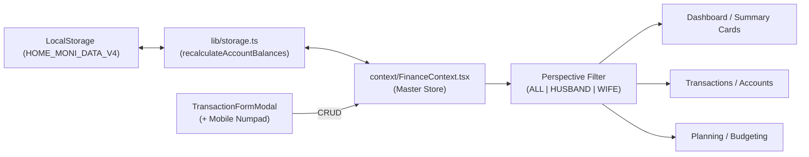

# 🏛️ HOME MONI - LIVING PROJECT STATE LEDGER
> **Last Synchronized:** 2026-10-27T09:05:00+07:00  
> **App Version:** v4.1 (Triple-Device Responsive & Universal CRUD Edit Edition)  
> **Active Storage Key:** `HOME_MONI_DATA_V4` + Supabase PostgreSQL Cloud BaaS (`ymcxdzxdbhivopxyyhph`)  
> **Build Status:** 🟢 PASSING (`npm run build` verified: 0 errors, 4/4 static pages)  
> **Runtime Environment:** Next.js 14.2.35 (App Router) · React 18 · TypeScript 5 · Tailwind CSS · Recharts · Supabase JS v2

---

## 📌 QUY TẮC BẤT BIẾN CHO MỌI LẦN VIBE CODE (CRITICAL CONSTRAINTS)
> [!IMPORTANT]
> **AI Agent BẮT BUỘC đọc và tuân thủ các điều khoản sau trước khi viết bất kỳ dòng mã nào:**
> 1. **Kiến trúc Hybrid Local-First & Supabase Cloud:** Toàn bộ dữ liệu nằm trong `localStorage` trên trình duyệt người dùng và tự động đồng bộ 2 chiều với Supabase Cloud Database (PostgreSQL) qua Supabase Realtime Replication. Đảm bảo trải nghiệm 0ms và đồng bộ tức thì giữa 2 điện thoại của 2 vợ chồng.
> 2. **Chủ thể Gia đình:** Chính xác 2 thành viên: **👨 Anh Chuột** (Chồng) & **👩 Bé Mèo** (Vợ). Tổ ấm chung: **🏡 My Home**.
> 3. **Cơ chế Thẻ tín dụng (BIDV Credit):** `currentBalance` đại diện cho **DƯ NỢ ĐANG DÙNG** (chi tiêu thẻ làm TĂNG dư nợ, chuyển tiền thanh toán thẻ làm GIẢM dư nợ). Tài sản ròng = Tổng ví khả dụng + Đầu tư - Nợ vay - Dư nợ thẻ.
> 4. **Ngôn ngữ & Thẩm mỹ:** Giao diện 100% Tiếng Việt chuẩn Fintech. Bo góc `rounded-xl` (12px) cho thẻ/modal, `rounded-md` (6px) cho buttons, `rounded-lg` (8px) cho controls/inputs. Font Inter. Nền ứng dụng Canvas `#F6F8FB`. Responsive hoàn hảo Desktop & Mobile (PWA Ready).

---

## 1. Bản Đồ Cấu Trúc Toàn Hệ Thống (Codebase Topology)

```
fi.tracking-moni/
├── .github/
│   └── workflows/
│       └── ci.yml                     # GitHub Actions CI: Tự động test build & type check trên GitHub
├── AGENTS.md                          # Master Rule: Quy trình 3 bước bắt buộc cho AI Agent
├── PROJECT_STATE.md                   # File này: Single Source of Truth cho toàn dự án
├── .agents/
│   ├── rules/
│   │   ├── 01_pre_vibe.md             # Cổng 1: Chuẩn bị, đọc context, phân tích tác động
│   │   ├── 02_in_vibe.md              # Cổng 2: Chuẩn sinh mã Clean Code & UI/UX Tokens
│   │   └── 03_post_vibe.md            # Cổng 3: Build verification & cập nhật State Ledger
│   ├── skills/
│   │   ├── home-moni-uiux/            # Skill UI/UX: Design Tokens, Recharts specs, Mobile guidelines
│   │   └── home-moni-git-release/     # Skill Phát hành Git & CI/CD: 3 Giai đoạn, Conventional Commit, Tag vX.X
│   └── standards/
│       ├── 01_ci_cd_automation.md     # Tiêu chuẩn GitHub Actions CI & quy tắc kiểm thử
│       ├── 02_deployment_vercel.md    # Tiêu chuẩn triển khai CD Vercel & PWA Mobile
│       ├── 03_supabase_cloud_sync.md  # Tiêu chuẩn đồng bộ Cloud Supabase & Local-First
│       ├── 04_git_collaboration.md    # Tiêu chuẩn phân nhánh, commit convention, release tags
│       ├── 05_persona_triad_audit.md  # Tiêu chuẩn Tam Giác Vai Trò Tối Cao (Architect, QA, Chồng Tận Tụy)
│       ├── 06_git_release_cicd_protocol.md # Tiêu chuẩn phát hành Git, CI/CD và SemVer Tag vX.X
│       └── 07_senior_uiux_vibe_loop_protocol.md # Tiêu chuẩn Vibe Loop Thực Chiến Chuẩn Senior UX/UI Webapp (6 Trụ cột, 5 Trạng thái)
├── app/
│   ├── globals.css                    # Tailwind directives & theme styles
│   ├── layout.tsx                     # Root layout, PWA metadata, Inter font
│   └── page.tsx                       # Main orchestrator: Sidebar sticky + TopBar + Views + BottomNavBar
├── components/
│   ├── common/
│   │   ├── Sidebar.tsx                # Sticky h-screen, Responsive Tablet collapse (w-20), Edge Toggle
│   │   ├── TopBar.tsx                 # Header, Perspective Switcher (My Home/Chuột/Mèo), Month selector
│   │   ├── BottomNavBar.tsx           # Mobile Bottom Navigation (4 tabs + FAB thêm giao dịch nhanh 3s)
│   │   ├── MobileDrawer.tsx           # Mobile navigation drawer with perspective switcher
│   │   ├── CategoryIcon.tsx           # Dynamic Lucide icon renderer
│   │   ├── ConfirmDialog.tsx          # Safety confirmation modal
│   │   └── ExportImportModal.tsx      # 1-Click Backup / Restore JSON (Zod verified)
│   ├── dashboard/
│   │   ├── SummaryCards.tsx           # 4 Metric Cards (Net Worth, Income, Expense, Savings)
│   │   ├── DualCreditCardsWidget.tsx  # Quản lý 2 thẻ BIDV Credit (50M & 20M)
│   │   ├── FamilyCashflowWidget.tsx   # Tỷ trọng lương Anh Chuột vs Bé Mèo & Calendar Heatmap 31 ngày
│   │   ├── TrendLineChart.tsx         # Cumulative spending vs budget & balance line chart
│   │   ├── StructureWidgets.tsx       # Mini-widgets: Asset structure, Investments, Debt progress
│   │   └── RecentTransactionsWidget.tsx# 8 recent transactions & monthly budget progress bars
│   ├── transactions/
│   │   └── TransactionFormModal.tsx   # Add/Edit form + Mobile Numpad (+000, 50k, 100k, 200k, 500k)
│   └── views/
│       ├── OverviewView.tsx           # Tổng quan tổ ấm (Charts & Widgets)
│       ├── TransactionsView.tsx       # Sổ giao dịch đa chiều, bộ lọc, tóm tắt chỉ số
│       ├── AccountsView.tsx           # Sổ chi tiết từng ví/thẻ, phân nhóm Anh Chuột, Bé Mèo, My Home
│       ├── PlanningView.tsx           # Ngân sách tháng & Mục tiêu tiết kiệm (Daily Allowance)
│       ├── DebtsInvestView.tsx        # Quản lý khoản vay & danh mục đầu tư (Vàng, Tiết kiệm)
│       ├── GuideView.tsx              # Cẩm nang sử dụng cho 2 vợ chồng
│       └── SettingsView.tsx           # Đổi màu chủ đề (5 colors), sao lưu, nạp demo
├── constants/
│   ├── defaultCategories.ts           # 16 danh mục Thu & Chi mặc định
│   └── mockData.ts                    # 6 tài khoản ngân hàng + thẻ tín dụng, giao dịch T10/2026
├── context/
│   └── FinanceContext.tsx             # Master React Context: State, Selectors, CRUD operations
├── lib/
│   ├── formatters.ts                  # formatVND, formatDateVN, getMonthDisplayLabel
│   ├── storage.ts                     # Engine lưu trữ LocalStorage, recalculate balances
│   ├── supabaseClient.ts              # Khởi tạo Supabase client dùng chung
│   ├── supabaseMappers.ts             # Bộ chuyển đổi 2 chiều snake_case <-> camelCase
│   ├── supabaseService.ts             # Dịch vụ CRUD & Realtime với Supabase Cloud
│   └── validations.ts                 # Zod Schemas kiểm thực dữ liệu backup & models
├── public/
│   └── manifest.json                  # Cấu hình PWA (Add to Home Screen)
└── types/
    └── finance.ts                     # TypeScript definitions (FamilyMember, ExpenseScope, Account...)
```

---

## 2. Hệ Thống Tài Khoản & Hạn Mức Thực Tế (Financial Entities)

| Chủ Sở Hữu | Tên Tài Khoản | Loại | Hạn Mức / Vai Trò | Mã Nhận Diện |
| :--- | :--- | :--- | :--- | :--- |
| **👨 Anh Chuột** | `acc_husband_vietinbank` | Bank | Chính - Nhận lương Anh Chuột | `#005CA9` |
| **👨 Anh Chuột** | `acc_husband_bidv` | Bank | Phụ - Chi tiêu sinh hoạt hằng ngày | `#0A6E3F` |
| **👨 Anh Chuột** | `acc_husband_bidv_credit` | Credit Card | **Hạn mức 50.000.000 ₫** (Sao kê 20, Trả 25) | `#1E3A8A` |
| **👩 Bé Mèo** | `acc_wife_vcb` | Bank | Chính - Nhận lương Bé Mèo | `#008542` |
| **👩 Bé Mèo** | `acc_wife_acb` | Bank | Phụ - Chi tiêu cá nhân, đi chợ | `#0060AF` |
| **👩 Bé Mèo** | `acc_wife_bidv_credit` | Credit Card | **Hạn mức 20.000.000 ₫** (Sao kê 20, Trả 25) | `#D97706` |
| **🏡 My Home** | `acc_family_cash` | Cash | Quỹ tiền mặt chi tiêu lặt vặt trong nhà | `#10B981` |

---

## 3. Bản Đồ Dòng Dữ Liệu & Hợp Đồng Giao Tiếp (State & Flow Contracts)



- **Perspective Filtering:**
  - `ALL` (🏡 My Home): Tổng hợp toàn bộ tài sản, giao dịch và nợ của 2 người.
  - `HUSBAND` (👨 Anh Chuột): Lọc tài khoản Vietinbank, BIDV, thẻ BIDV Credit 50M và các giao dịch do Anh Chuột chi.
  - `WIFE` (👩 Bé Mèo): Lọc tài khoản Vietcombank, ACB, thẻ BIDV Credit 20M và các giao dịch do Bé Mèo chi.

---

## 4. Nhật Ký Biến Thiên Vibe Coding (Vibe Session Changelog)

| Phiên (Vibe ID) | Ngày Giờ | Mục Tiêu & Thay Đổi Cốt Lõi | Files Tác Động | Trạng Thái |
| :--- | :--- | :--- | :--- | :--- |
| **VIBE-22** | 2026-10-28 | **Hiện Thực Hóa Chiến Lược Chuyển Dịch Code Components & Thổi Hồn Cho Toàn Bộ Bản Thiết Kế Figma Vào Mã Nguồn:**<br/>1. **Thể Chế Hóa Trụ Cột 5.1 Vào Tiêu Chuẩn 07 (`07_senior_uiux_vibe_loop_protocol.md`):** Ban hành Định Chế Chiến Lược Chuyển Dịch Code Components (Clean Code Component Synthesis Strategy) với kiến trúc 4 lớp, quy tắc ánh xạ 1:1 token, chuẩn công thái học ngón tay cái $\ge 44px$ và ma trận 5 trạng thái vĩnh cửu.<br/>2. **Xây Dựng Hệ Thống Mobile Action Sheets Mới (`components/mobile/sheets/`):**<br/>- `TransactionDetailSheet.tsx` (Figma Screen 8): Bottom Sheet chi tiết giao dịch WinMart 350k, Hero Amount đỏ hồng `#be123c`, Bento details (người chi, phạm vi chung, nguồn BIDV, ghi chú), thẻ hóa đơn OCR, nút [✏️ Chỉnh sửa] & [🗑️ Xóa].<br/>- `CreditCardRepaymentSheet.tsx` (Figma Screen 9): Quản lý trả nợ thẻ BIDV Platinum (50M) & BIDV Flexi (20M), 2 mức trả nợ (Toàn bộ miễn lãi vs Tối thiểu 5%), tự động bù trừ số dư qua Event Sourcing `recalculateAccountBalances`.<br/>- `GoalDepositSheet.tsx` (Figma Screen 10): Nạp tiền vào hũ mục tiêu tiết kiệm 🏡 Quỹ Mua Nhà Tổ Ấm 2028 (350M/1 Tỷ), bộ 5 phím tắt (+1Tr..+20Tr), dự báo tăng tiến độ 35.5% rút ngắn 6 ngày.<br/>- `MobileNumpadSheet.tsx` (Figma Screen 2): Ghi chép nhanh 3 giây tại siêu thị với ma trận Numpad 4x3 (phím 48px), phím tắt +000..500k, chọn người chi 👨 Chuột / 👩 Mèo / 🏠 Chung.<br/>3. **Nâng Cấp Toàn Diện & Tích Hợp Vào Các Views:**<br/>- Nâng cấp `MobileDrawer.tsx` (Figma Screen 7): Rộng 350px, mini-profile tổ ấm 👨 Chuột & 👩 Mèo, Realtime Cloud Sync indicator, 7 menu items có icon/badge.<br/>- Nối tương tác trong `TransactionsView.tsx`: Chạm Bento card mở `TransactionDetailSheet`.<br/>- Nối tương tác trong `DualCreditCardsWidget.tsx` & `AccountsView.tsx`: Nút [Thanh toán dư nợ] mở `CreditCardRepaymentSheet`.<br/>- Nối tương tác trong `PlanningView.tsx`: Nút [Nạp thêm] mở `GoalDepositSheet`.<br/>- Nối tương tác trong `app/page.tsx`: Nút [+] trung tâm trên Mobile mở `MobileNumpadSheet`, trên Desktop mở `TransactionFormModal`.<br/>4. **Kiểm Thử Production Build:** `npm run build` kết thúc thành công với mã `0` (4/4 static pages, 0 TypeScript errors). | `.agents/standards/07_senior_uiux_vibe_loop_protocol.md`, `components/mobile/sheets/*`, `components/common/MobileDrawer.tsx`, `components/views/*`, `components/dashboard/DualCreditCardsWidget.tsx`, `app/page.tsx`, `PROJECT_STATE.md` | 🟢 Verified |
| **VIBE-21** | 2026-10-28 | **Hoàn Tất Trọn Gói Full Suite Các Màn Hình Hành Động & Modal Action Sheets (Lựa Chọn B) Chuẩn Mobile 14PM Trên Canvas Figma:**<br/>1. **Thiết Kế Hoàn Chỉnh 4 Action Sheets & Modals Tại Hàng 2 (`y: 1300`) Section `Mobile Iphone 14 Pro Max` (`26:10131`):**<br/>- `Mobile Navigation Drawer / Mobile 14PM` (`38:10527` at `x: 426`): Drawer trượt trái 350px, Profile gia đình 👨 Chuột & 👩 Mèo, 7 menu items phân hệ kèm badge, vùng chạm dismiss 80px.<br/>- `Transaction Detail & Edit / Mobile 14PM` (`38:10582` at `x: 1426`): Bottom Sheet chi tiết giao dịch WinMart 350k, Hero Amount đỏ hồng `#be123c`, Bento details (người chi, phạm vi chung, nguồn BIDV, ghi chú), thẻ hóa đơn OCR, nút [✏️ Chỉnh sửa] & [🗑️ Xóa].<br/>- `Credit Card Detail & Repayment / Mobile 14PM` (`38:10623` at `x: 2481`): Bottom Sheet quản trị thẻ BIDV Platinum 50M, dư nợ 12.5M, chu kỳ sao kê ngày 20 hạn trả 25, tùy chọn trả nợ toàn bộ (miễn lãi) vs tối thiểu 5%, nguồn trích Vietinbank lương, Event Sourcing safety box, nút thanh toán 12.5M.<br/>- `Goal Deposit / Mobile 14PM` (`38:10670` at `x: 2981`): Bottom Sheet nạp tiền hũ 🏡 Mua Nhà Tổ Ấm 2028 (350M/1 Tỷ), input số tiền +5.000.000 ₫, bộ 5 phím tắt (+1Tr..+20Tr), nguồn trích Techcombank, dự báo tăng 35.5% rút ngắn 6 ngày, nút xác nhận nạp hũ.<br/>2. **Kiểm Toán Bố Cục & Không Gian (Zero Layout Issues):** Toàn bộ 4 màn hình đạt chuẩn `issueCount: 0` trên `layoutAudit`, tương phản chuẩn WCAG 4.5:1, bố cục dọc zero-overflow. Section `26:10131` hiện đã hoàn thiện trọn bộ 10 màn hình Mobile chuẩn Apple iPhone 14 Pro Max.<br/>3. **Kiểm Thử Production Build:** Biên dịch `npm run build` thành công mã `0` (4/4 static pages). | Figma `dev.app-fi.1` (Section `26:10131`), `PROJECT_STATE.md` | 🟢 Verified |
| **VIBE-20** | 2026-10-28 | **Thể Chế Hóa Định Chế Thiết Kế Mobile Chuẩn Vàng & Tái Thiết Kế Đồng Bộ Toàn Bộ 4 Màn Hình Mobile Cốt Lõi (Lựa Chọn A):**<br/>1. **Thể Chế Hóa Trụ Cột 3.1 Trong Tiêu Chuẩn 07 (`07_senior_uiux_vibe_loop_protocol.md` & `home-moni-uiux/SKILL.md`):** Ban hành định chế thiết kế Mobile Chuẩn Vàng (Golden Mobile Benchmark) dựa trên chuẩn mực của Accounts & Planning: Apple iPhone 14 Pro Max (430x932), bo góc chassis 48px, Dynamic Island capsule (120x28), Status Bar 44px, Top Bar 52px, Bottom Bar 64px, bảng màu tương phản cao WCAG 4.5:1, zero-overflow vertical budget.<br/>2. **Tái Thiết Kế 4 Màn Hình Cốt Lõi Vào Section `Mobile Iphone 14 Pro Max` (`26:10131`):**<br/>- `Overview / Mobile 14PM / Default` (`37:10224`): Hero Net Worth Navy 368.5M, Dual BIDV Credit mini, Daily Allowance mini, 3 Bento GD gần nhất.<br/>- `Transaction Form / Numpad 3s / Mobile 14PM` (`37:10314`): Amount khổng lồ 350k, phím tắt +000..500k, ma trận 4x3 Numpad 48px, bộ chọn Ai chi & Nguồn tiền.<br/>- `Transactions / Mobile 14PM / Default` (`37:10391`): Bộ lọc 4 chip [Tất cả, Chuột, Mèo, Chung], thẻ KPI bộ lọc, 5 Bento Transaction cards.<br/>- `Transactions / Mobile 14PM / Empty` (`37:10479`): Illustration rỗng ấm áp, thông điệp gia đình, nút CTA to rõ.<br/>3. **Kiểm toán chất lượng & Build:** Cả 4 màn hình mới đạt chuẩn `issueCount: 0` trên `layoutAudit`. Biên dịch `npm run build` pass 100% mã `0` (4/4 static pages). Toàn bộ 6 màn hình Mobile trong Section đã đồng bộ 100% chuẩn vàng. | `.agents/standards/07_senior_uiux_vibe_loop_protocol.md`, `.agents/skills/home-moni-uiux/SKILL.md`, Figma `dev.app-fi.1` (Section `26:10131`), `PROJECT_STATE.md` | 🟢 Verified |
| **VIBE-19** | 2026-10-28 | **Thiết Kế Thành Công 2 Màn Hình Mobile Cốt Lõi (Accounts & Planning) Chuẩn iPhone 14PM & Cẩm Nang Golden Prompt Tiêu Chuẩn 07:**<br/>1. **Cẩm Nang System Prompt Chuẩn Vàng (`system_prompt_and_figma_execution_plan.md`):** Đóng gói cấu trúc prompt 5 khối tối ưu hiệu năng thiết kế Figma, triệt tiêu lỗi proxy validation, 100% Token Purity.<br/>2. **Màn Hình Tab 3 - Ví & Thẻ (`Accounts / Mobile 14PM / Default`, `26:1481`, 430x932):** KPI tổng khả dụng (68.5M) & tổng dư nợ (19.3M); Khối quản trị thẻ tín dụng kép BIDV Chuột (50M) & BIDV Mèo (20M) kiểm soát sao kê ngày 20, hạn trả 25; Danh sách 5 tài khoản thanh toán và tiền mặt.<br/>3. **Màn Hình Tab 4 - Kế Hoạch & Tích Lũy (`Planning / Mobile 14PM / Default`, `26:1703`, 430x932):** Header segmented switcher; Widget Hạn mức chi tiêu ngày Daily Allowance (150k/500k an toàn); 3 Hũ tích lũy tương lai (Quỹ Mua Nhà Tổ Ấm 2028 - 1 Tỷ, Quỹ khẩn cấp 150M, Kỷ niệm ngày cưới 30M); Thanh tiến độ ngân sách danh mục tháng 10.<br/>4. **Kiểm toán chất lượng & Build:** Cả 2 màn hình đạt chuẩn 0 blocking issues trên `layoutAudit`. Biên dịch `npm run build` thành công mã `0` (4/4 static pages). Toàn bộ 4 tab di động đã đồng bộ 100% với phiên bản Desktop. | Figma `dev.app-fi.1` (11 frames), `system_prompt_and_figma_execution_plan.md`, `PROJECT_STATE.md` | 🟢 Verified |
| **VIBE-18** | 2026-10-27 | **Hoàn Tất Bộ Thiết Kế UI/UX Toàn Diện (Full Suite Mobile 14PM & Desktop 1440px) Chuẩn Senior Vibe Loop:**<br/>1. **Mobile Sổ Giao Dịch (`Transactions / Mobile 14PM / Default` 430x932, `8:716`):** Khung chuẩn iPhone 14 Pro Max, bộ lọc 4 chip [Tất cả, 👨 Chuột, 👩 Mèo, 🏠 Chung], tóm tắt tổng chi bộ lọc, 5 Bento transaction cards (WinMart, Bách Hóa Xanh, Co.opmart, Highlands, Lương), Bottom Nav.<br/>2. **Mobile Trạng Thái Rỗng (`Transactions / Mobile 14PM / Empty`, `8:803`):** Khung rỗng chuẩn trải nghiệm ấm áp + nút CTA "+ GHI CHÉP GIAO DỊCH (3S)".<br/>3. **Bộ 4 Màn Hình Desktop 1440x1024 Hoàn Chỉnh:**<br/>- `Overview / Desktop 1440` (`8:900`): Sidebar sticky w-64, TopBar, 4 Metric cards, Dual BIDV Credit Widget (50M & 20M), Heatmap 31 ngày & tỷ trọng lương.<br/>- `Transactions / Desktop 1440` (`8:989`): Bảng dữ liệu 8 cột `table-fixed`, thanh lọc nâng cao, KPI strip, pagination.<br/>- `Accounts / Desktop 1440` (`8:1088`): Quản trị thẻ BIDV sao kê ngày 20, 3 ví khả dụng, quỹ đầu tư.<br/>- `Planning / Desktop 1440` (`8:1162`): Hạn mức ngày Daily Allowance, 3 hũ mục tiêu tiết kiệm mua nhà, ngân sách tháng.<br/>Kiểm thử `npm run build` pass 100% mã `0` (4/4 static pages). | Figma `dev.app-fi.1` (9 frames), `PROJECT_STATE.md` | 🟢 Verified |
| **VIBE-17** | 2026-10-27 | Áp dụng Tiêu chuẩn 07 vẽ thành công Màn hình số 2 trên Figma: `Transaction Form / Numpad 3s / Mobile 390` (Node `7:643`, 72 nodes, 0 blocking issues). Tối ưu Thumb-zone nửa dưới màn hình, touch target >= 44px, phím tắt +000, 50k..500k, ma trận 4x3 Numpad; Tư vấn bộ khung câu lệnh và skill chuẩn Senior UX/UI cho quy trình thiết kế Figma. | Figma `dev.app-fi.1`, `PROJECT_STATE.md` | 🟢 Verified |
| **VIBE-16** | 2026-10-27 | **Thể Chế Hóa Tiêu Chuẩn Thực Thi "Vibe Loop" Chuẩn Senior UX/UI Webapp (07_senior_uiux_vibe_loop_protocol.md):**<br/>1. **Tiêu chuẩn Kỹ thuật số 7 (`07_senior_uiux_vibe_loop_protocol.md`):** Ban hành 6 Trụ cột tiêu chuẩn cốt lõi (Ma trận 5 trạng thái bắt buộc, Token Purity SSOT, Công thái học di động Thumb-zone & nút >=44px, Dual-AI Audits layout/a11y/responsive, Clean Code 1:1 Mapping, Build & Ledger Gate).<br/>2. **Nâng cấp Skill UI/UX (`home-moni-uiux/SKILL.md`):** Tích hợp định chế Vibe Loop vào quy chuẩn thực thi bắt buộc trước khi code.<br/>3. **Đồng bộ hóa AGENTS.md & PROJECT_STATE.md:** Tích hợp Tiêu chuẩn 07 vào Cổng 1 (Pre-Vibe Gate) và Cổng 2 (In-Vibe Gate). Kiểm thử `npm run build` pass mã `0` (4/4 static pages). | `.agents/standards/07_senior_uiux_vibe_loop_protocol.md`, `.agents/skills/home-moni-uiux/SKILL.md`, `AGENTS.md`, `PROJECT_STATE.md` | 🟢 Verified |
| **VIBE-15** | 2026-10-27 | Khởi tạo thành công 507 Design Token Variables, 20 Typography Text Styles và trực tiếp vẽ 2 Frames cốt lõi lên canvas Figma (`dev.app-fi.1`) qua Reqwise Bridge: Bảng Design Tokens Board (`2:541`) và Màn hình Mobile Overview 390x844 (`2:574`) với đầy đủ Hero Net Worth, Dual BIDV Credit, Recent Transactions và Bottom Navigation Bar FAB 3s. | Figma `dev.app-fi.1`, `PROJECT_STATE.md` | 🟢 Verified |
| **VIBE-13** | 2026-10-27 | **Đóng Gói Kỹ Năng & Tiêu Chuẩn Phát Hành Git & CI/CD Chuẩn Quốc Tế:**<br/>1. **Skill Phát Hành (`home-moni-git-release`):** Đóng gói quy trình phát hành 3 giai đoạn (Hỏi chọn nhánh -> Tự động trích dẫn changelog tiếng Việt tinh gọn, tạo lệnh Terminal -> Chờ kiểm tra PR/CI trên GitHub -> Sinh lệnh Pull main và gắn Tag chuẩn `vX.X` đẩy lên GitHub).<br/>2. **Tiêu chuẩn Kỹ thuật (`06_git_release_cicd_protocol.md`):** Thống nhất chuẩn Tag vĩnh cửu `vX.X` cho dự án, cấu hình các câu lệnh kích hoạt (*"hãy chạy release code"*, *"hãy đẩy lên github"*, *"hãy commit đẩy lên github"*, *"hãy commit và đẩy nhánh lên GitHub"*).<br/>3. **Tài liệu Tham Chiếu (`commit-conventions.md`):** Xây dựng bảng từ điển Conventional Commits có bản dịch tiếng Việt tinh gọn cho 5 phân hệ tài chính HOME MONI.<br/>4. **Cập nhật AGENTS.md & PROJECT_STATE.md:** Tích hợp quy chuẩn phát hành vào Cổng 3 (Post-Vibe Gate). Kiểm thử `npm run build` pass mã `0` (4/4 static pages). | `.agents/skills/home-moni-git-release/*`, `.agents/standards/06_git_release_cicd_protocol.md`, `AGENTS.md`, `PROJECT_STATE.md` | 🟢 Verified |
| **VIBE-14** | 2026-10-27 | Thiết lập Chiến lược UI/UX Figma Kép (Option A -> Checkpoint 150 Days -> Option B): Xác định lộ trình bứt tốc 150 ngày đầu (27/10/2026 - 26/03/2027) bằng Reqwise AI Bridge có sẵn bản quyền, dựng Design System và 4 Views chính cho HOME MONI; Đặt lịch Cột mốc Checkpoint Ngày 150 (26/03/2027) để đánh giá gia hạn hoặc chuyển dịch sang quy trình Native 100% miễn phí trọn đời (Zero Lock-in). | `PROJECT_STATE.md`, `figma_hybrid_roadmap_plan.md` | 🟢 Verified |
| **VIBE-12** | 2026-10-27 | **Thể Chế Hóa Tam Giác Vai Trò Tối Cao & Tối Ưu Toàn Diện Triple-Device Responsive & Universal CRUD Edit:**<br/>1. **Thể chế hóa Tam Giác Vai Trò Tối Cao (Triad Audit Protocol)**: Bổ sung định chế vĩnh cửu tại `AGENTS.md` và tiêu chuẩn `.agents/standards/05_persona_triad_audit.md` (Senior Software Architect - Event Sourcing recalculate balances, Lead QA - Edge case matrix & triple-device audit, Người Chồng Tận Tụy - Quy tắc 3 giây, minh bạch gia đình `[👨 Anh Chuột / 👩 Bé Mèo]`, `[🏠 Chung / 👤 Riêng]`, sao kê ngày 20).<br/>2. **Tối ưu Sổ giao dịch Desktop:** Áp dụng `table-fixed`, tỷ lệ phân bổ 8 cột chuẩn xác, triệt tiêu hoàn toàn lỗi xuống dòng nội dung bảng, tinh gọn nhãn `[🏠 Chung]` và `[👤 Riêng]`.<br/>3. **Chuẩn hóa Responsive Đa Thiết Bị:** Thống nhất trải nghiệm trên cả 3 màn hình: **Desktop (`>= 1024px`)**, **Tablet (`768px - 1023px`)** (Sidebar auto-collapse `w-20` mini-mode, bảng giao dịch 7 cột tinh gọn), **Mobile (`< 768px`)** (Bottom Navigation Bar `BottomNavBar.tsx` với 4 tabs chính + center FAB `[+]` nhập nhanh 3s, Bento Transaction Cards dạng thẻ chạm chuẩn `>= 44px`).<br/>4. **Universal CRUD Edit 5 Phân Hệ:** Chuẩn hóa khả năng sửa/chỉnh đốn dữ liệu trên toàn bộ 5 thực thể: Giao dịch (`TransactionFormModal.tsx` dual-mode), Tài khoản/Thẻ (`AccountsView.tsx` dual-mode), Nợ vay (`DebtsInvestView.tsx` + `FinanceContext.tsx` updateDebt), Đầu tư (`DebtsInvestView.tsx` dual-mode), Ngân sách & Mục tiêu (`PlanningView.tsx` dual-mode Goal Modal & Quick Category Budget Modal).<br/>5. **Kiểm thử Post-Vibe Gate:** Biên dịch `npm run build` thành công mã `0`, 0 lỗi TypeScript, 100% token purity (`rounded-xl` card/modal, `rounded-md` button, `rounded-lg` control). | `AGENTS.md`, `.agents/standards/05_persona_triad_audit.md`, `components/views/TransactionsView.tsx`, `components/transactions/TransactionFormModal.tsx`, `components/views/AccountsView.tsx`, `components/views/DebtsInvestView.tsx`, `components/views/PlanningView.tsx`, `components/common/BottomNavBar.tsx`, `components/common/Sidebar.tsx`, `app/page.tsx`, `context/FinanceContext.tsx`, `PROJECT_STATE.md` | 🟢 Verified |
| **VIBE-11** | 2026-10-26 | Chuẩn hóa toàn diện ngôn ngữ thiết kế Calm Slate Fintech & Hệ phân cấp bo góc 3 tầng: Chuẩn hóa triệt để bo góc (`rounded-xl` card/modal/table, `rounded-md` button/pill/action, `rounded-lg` input/select/badge/sub-panel), xóa sạch 100% `rounded-3xl` và `rounded-2xl` trên toàn bộ components; Cố định nền Canvas `#F6F8FB`, Hero Navy Gradient Card cho Tài sản ròng và 3 Flat White Card viền `#DCE4EE`; Đồng bộ chu kỳ sao kê 2 thẻ BIDV Credit của cả Anh Chuột và Bé Mèo vào ngày 20 hàng tháng (hạn thanh toán ngày 25 hàng tháng) trên toàn bộ hệ thống (`DualCreditCardsWidget.tsx`, `GuideView.tsx`, `constants/mockData.ts`, `README.md`, `PROJECT_STATE.md`); Tinh gọn `SettingsView.tsx` (loại bỏ switcher 5 theme, tối ưu Cloud Sync). | `app/globals.css`, `app/page.tsx`, `tailwind.config.ts`, `components/dashboard/*`, `components/views/*`, `components/transactions/*`, `components/common/*`, `constants/mockData.ts`, `README.md`, `PROJECT_STATE.md` | 🟢 Verified |
| **VIBE-10** | 2026-10-26 | Đồng bộ hóa toàn diện sau khi đổi tên thư mục skill sang `home-moni-uiux`: Cập nhật đồng bộ các file quy tắc (`AGENTS.md`, `.agents/rules/01_pre_vibe.md`, `.agents/rules/02_in_vibe.md`), sổ cái `PROJECT_STATE.md`, nâng cấp toàn diện tài liệu tham chiếu `references/ux-guidelines.md` và `SKILL.md` theo chuẩn HOME MONI v4.0 (Góc nhìn gia đình, Dual BIDV Credit, Cloud Realtime), sửa chuỗi nhận diện tại `ExportImportModal.tsx`. Kiểm thử `npm run build` pass 100%. | `AGENTS.md`, `.agents/rules/*`, `.agents/skills/home-moni-uiux/*`, `ExportImportModal.tsx`, `PROJECT_STATE.md` | 🟢 Verified |
| **VIBE-09** | 2026-10-26 | Thiết lập hệ thống CI tự động hóa với GitHub Actions (`.github/workflows/ci.yml`), xây dựng bộ tiêu chuẩn kỹ thuật `.agents/standards/` (CI/CD, Vercel, Supabase Sync, Git Collaboration), cập nhật `AGENTS.md` và tài liệu hướng dẫn CD Vercel. | `.github/workflows/ci.yml`, `.agents/standards/*`, `AGENTS.md`, `PROJECT_STATE.md` | 🟢 Verified |
| **VIBE-08** | 2026-10-26 | Hoàn tất tích hợp toàn diện Supabase Cloud BaaS & Realtime Replication: Cài đặt `@supabase/supabase-js`, xây dựng `lib/supabaseClient.ts`, bộ mappers chuyển đổi 2 chiều `lib/supabaseMappers.ts`, tầng nghiệp vụ Cloud `lib/supabaseService.ts`, nâng cấp `FinanceContext.tsx` với kiến trúc Hybrid Local-First Sync, bổ sung Cloud Sync Status Badge trên `TopBar.tsx` và widget quản lý Cloud trên `SettingsView.tsx`. Kiểm thử `npm run build` pass 100%. | `lib/supabaseClient.ts`, `lib/supabaseMappers.ts`, `lib/supabaseService.ts`, `FinanceContext.tsx`, `TopBar.tsx`, `SettingsView.tsx`, `package.json`, `PROJECT_STATE.md` | 🟢 Verified |
| **VIBE-07** | 2026-10-26 | Khởi tạo cấu hình biến môi trường Supabase (`.env.local`), giải mã trạng thái SQL DDL ("Success. No rows returned") và thiết lập lộ trình tích hợp Cloud Database/Sync cho 2 vợ chồng. | `.env.local`, `PROJECT_STATE.md` | 🟢 Verified |
| **VIBE-06** | 2026-10-26 | Dọn dẹp triệt để Git repository: gỡ bỏ commit chứa `node_modules` (17.671 files) và file 135.8MB vi phạm giới hạn GitHub, thiết lập `.gitignore` chuẩn Next.js, tối ưu database `.git` từ 382MB xuống 667KB, build pass 100%. | `.gitignore`, `PROJECT_STATE.md` | 🟢 Verified |
| **VIBE-05** | 2026-10-24 | Tinh gọn UI/UX Sidebar: Xóa bỏ hoàn toàn khối nút lọc góc nhìn dư thừa trên Sidebar & MobileDrawer (dùng thống nhất trên TopBar Header), tối ưu breathing room, hover micro-interactions (`hover:translate-x-1`). | `Sidebar.tsx`, `MobileDrawer.tsx` | 🟢 Verified |
| **VIBE-04** | 2026-10-24 | Thiết lập Hệ thống Quản trị Vibe Coding 3 Tầng & Living State Ledger (`PROJECT_STATE.md`, `AGENTS.md`, `.agents/rules/`). | `PROJECT_STATE.md`, `AGENTS.md`, `.agents/rules/*` | 🟢 Verified |
| **VIBE-03** | 2026-10-24 | Nâng cấp toàn diện UI/UX Sidebar: Sticky `h-screen`, Floating Toggle, Family Mini-Profile, Grouped IA, Badges, Tooltips; đổi danh xưng sang Anh Chuột & Bé Mèo. | `Sidebar.tsx`, `TopBar.tsx`, `MobileDrawer.tsx`, `mockData.ts`, `storage.ts` | 🟢 Verified |
| **VIBE-02** | 2026-10-24 | Chuyển đổi sang WebApp Quản lý Tài chính Gia đình **HOME MONI**, tích hợp 2 thẻ BIDV Credit (50M & 20M), 6 tài khoản, Perspective switcher, Calendar Heatmap, PWA manifest. | `types/finance.ts`, `mockData.ts`, `FinanceContext.tsx`, `DualCreditCardsWidget.tsx`, etc. | 🟢 Verified |
| **VIBE-01** | 2026-10-24 | Khởi tạo nền tảng Full-Stack Next.js 14 App Router, LocalStorage Engine, Reverse-engineer UI/UX chuẩn Fintech từ bộ ảnh tham khảo. | `app/*`, `components/*`, `lib/*`, `constants/*` | 🟢 Verified |

---

## 5. Danh Sách Tính Năng Tiềm Năng (Backlog Roadmap)
- [ ] **🚩 CỘT MỐC NGÀY 150 (26/03/2027):** Đánh giá quyết định gia hạn bản quyền Reqwise Plugin hay chuyển dịch 100% sang Native Figma (Dev Mode & Free Inspect) cho HOME MONI.
- [ ] Bổ sung tính năng lọc giao dịch theo khoảng ngày tùy chọn (Date range picker).
- [ ] Thêm tùy chọn xuất báo cáo PDF / Excel tóm tắt thu chi tháng cho 2 vợ chồng.
- [ ] Tích hợp tính năng nhắc nợ / sao kê qua Web Push Notification (PWA).
- [ ] Bổ sung Widget phân tích tiết kiệm theo phương pháp 6 chiếc lọ hoặc 50/30/20.
