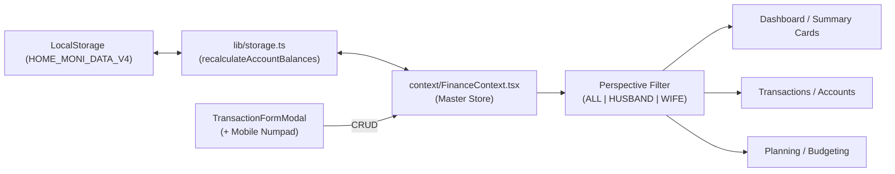

# 🏛️ HOME MONI - LIVING PROJECT STATE LEDGER
> **Last Synchronized:** 2026-10-26T08:44:00+07:00  
> **App Version:** v3.3 (Streamlined Sidebar UX Edition)  
> **Active Storage Key:** `HOME_MONI_DATA_V4`  
> **Build Status:** 🟢 PASSING (`npm run build` verified: 0 errors, 4/4 static pages)  
> **Runtime Environment:** Next.js 14.2.35 (App Router) · React 18 · TypeScript 5 · Tailwind CSS · Recharts

---

## 📌 QUY TẮC BẤT BIẾN CHO MỌI LẦN VIBE CODE (CRITICAL CONSTRAINTS)
> [!IMPORTANT]
> **AI Agent BẮT BUỘC đọc và tuân thủ các điều khoản sau trước khi viết bất kỳ dòng mã nào:**
> 1. **Kiến trúc Local-First:** Toàn bộ dữ liệu nằm trong `localStorage` trên trình duyệt người dùng. Tuyệt đối KHÔNG cài đặt backend database server (Prisma, PostgreSQL, MongoDB, v.v.).
> 2. **Chủ thể Gia đình:** Chính xác 2 thành viên: **👨 Anh Chuột** (Chồng) & **👩 Bé Mèo** (Vợ). Tổ ấm chung: **🏡 My Home**.
> 3. **Cơ chế Thẻ tín dụng (BIDV Credit):** `currentBalance` đại diện cho **DƯ NỢ ĐANG DÙNG** (chi tiêu thẻ làm TĂNG dư nợ, chuyển tiền thanh toán thẻ làm GIẢM dư nợ). Tài sản ròng = Tổng ví khả dụng + Đầu tư - Nợ vay - Dư nợ thẻ.
> 4. **Ngôn ngữ & Thẩm mỹ:** Giao diện 100% Tiếng Việt chuẩn Fintech. Bo góc `rounded-3xl` cho thẻ/modal, `rounded-xl` cho controls. Font Inter. Responsive hoàn hảo Desktop & Mobile (PWA Ready).

---

## 1. Bản Đồ Cấu Trúc Toàn Hệ Thống (Codebase Topology)

```
fi.tracking-moni/
├── AGENTS.md                          # Master Rule: Quy trình 3 bước bắt buộc cho AI Agent
├── PROJECT_STATE.md                   # File này: Single Source of Truth cho toàn dự án
├── .agents/
│   ├── rules/
│   │   ├── 01_pre_vibe.md             # Cổng 1: Chuẩn bị, đọc context, phân tích tác động
│   │   ├── 02_in_vibe.md              # Cổng 2: Chuẩn sinh mã Clean Code & UI/UX Tokens
│   │   └── 03_post_vibe.md            # Cổng 3: Build verification & cập nhật State Ledger
│   └── skills/
│       └── lovely-money-uiux/         # Skill UI/UX: Design Tokens, Recharts specs, Mobile guidelines
├── app/
│   ├── globals.css                    # Tailwind directives & theme styles
│   ├── layout.tsx                     # Root layout, PWA metadata, Inter font
│   └── page.tsx                       # Main orchestrator: Sidebar sticky + TopBar + Views
├── components/
│   ├── common/
│   │   ├── Sidebar.tsx                # Sticky h-screen, Floating Edge Toggle, Mini Profile, Grouped IA
│   │   ├── TopBar.tsx                 # Header, Perspective Switcher (My Home/Chuột/Mèo), Month selector
│   │   ├── MobileDrawer.tsx           # Mobile navigation drawer with perspective switcher
│   │   ├── CategoryIcon.tsx           # Dynamic Lucide icon renderer
│   │   ├── ConfirmDialog.tsx          # Safety confirmation modal
│   │   └── ExportImportModal.tsx      # 1-Click Backup / Restore JSON (Zod verified)
│   ├── dashboard/
│   │   ├── SummaryCards.tsx           # 4 Metric Cards (Net Worth, Income, Expense, Savings)
│   │   ├── DualCreditCardsWidget.tsx  # Quản lý 2 thẻ BIDV Credit (50M & 20M)
│   │   ├── FamilyCashflowWidget.tsx   # Tỷ trọng lương Anh Chuột vs Bé Mèo & Calendar Heatmap 31 ngày
│   │   ├── TrendLineChart.tsx         # Cumulative spending vs budget & balance line chart
│   │   ├── StructureWidgets.tsx       # Mini-widgets: Asset structure, Investments, Debt progress
│   │   └── RecentTransactionsWidget.tsx# 8 recent transactions & monthly budget progress bars
│   ├── transactions/
│   │   └── TransactionFormModal.tsx   # Add/Edit form + Mobile Numpad (+000, 50k, 100k, 200k, 500k)
│   └── views/
│       ├── OverviewView.tsx           # Tổng quan tổ ấm (Charts & Widgets)
│       ├── TransactionsView.tsx       # Sổ giao dịch đa chiều, bộ lọc, tóm tắt chỉ số
│       ├── AccountsView.tsx           # Sổ chi tiết từng ví/thẻ, phân nhóm Anh Chuột, Bé Mèo, My Home
│       ├── PlanningView.tsx           # Ngân sách tháng & Mục tiêu tiết kiệm (Daily Allowance)
│       ├── DebtsInvestView.tsx        # Quản lý khoản vay & danh mục đầu tư (Vàng, Tiết kiệm)
│       ├── GuideView.tsx              # Cẩm nang sử dụng cho 2 vợ chồng
│       └── SettingsView.tsx           # Đổi màu chủ đề (5 colors), sao lưu, nạp demo
├── constants/
│   ├── defaultCategories.ts           # 16 danh mục Thu & Chi mặc định
│   └── mockData.ts                    # 6 tài khoản ngân hàng + thẻ tín dụng, giao dịch T10/2026
├── context/
│   └── FinanceContext.tsx             # Master React Context: State, Selectors, CRUD operations
├── lib/
│   ├── formatters.ts                  # formatVND, formatDateVN, getMonthDisplayLabel
│   ├── storage.ts                     # Engine lưu trữ LocalStorage, recalculate balances
│   └── validations.ts                 # Zod Schemas kiểm thực dữ liệu backup & models
├── public/
│   └── manifest.json                  # Cấu hình PWA (Add to Home Screen)
└── types/
    └── finance.ts                     # TypeScript definitions (FamilyMember, ExpenseScope, Account...)
```

---

## 2. Hệ Thống Tài Khoản & Hạn Mức Thực Tế (Financial Entities)

| Chủ Sở Hữu | Tên Tài Khoản | Loại | Hạn Mức / Vai Trò | Mã Nhận Diện |
| :--- | :--- | :--- | :--- | :--- |
| **👨 Anh Chuột** | `acc_husband_vietinbank` | Bank | Chính - Nhận lương Anh Chuột | `#005CA9` |
| **👨 Anh Chuột** | `acc_husband_bidv` | Bank | Phụ - Chi tiêu sinh hoạt hằng ngày | `#0A6E3F` |
| **👨 Anh Chuột** | `acc_husband_bidv_credit` | Credit Card | **Hạn mức 50.000.000 ₫** (Sao kê 20, Trả 25) | `#1E3A8A` |
| **👩 Bé Mèo** | `acc_wife_vcb` | Bank | Chính - Nhận lương Bé Mèo | `#008542` |
| **👩 Bé Mèo** | `acc_wife_acb` | Bank | Phụ - Chi tiêu cá nhân, đi chợ | `#0060AF` |
| **👩 Bé Mèo** | `acc_wife_bidv_credit` | Credit Card | **Hạn mức 20.000.000 ₫** (Sao kê 22, Trả 28) | `#D97706` |
| **🏡 My Home** | `acc_family_cash` | Cash | Quỹ tiền mặt chi tiêu lặt vặt trong nhà | `#10B981` |

---

## 3. Bản Đồ Dòng Dữ Liệu & Hợp Đồng Giao Tiếp (State & Flow Contracts)



- **Perspective Filtering:**
  - `ALL` (🏡 My Home): Tổng hợp toàn bộ tài sản, giao dịch và nợ của 2 người.
  - `HUSBAND` (👨 Anh Chuột): Lọc tài khoản Vietinbank, BIDV, thẻ BIDV Credit 50M và các giao dịch do Anh Chuột chi.
  - `WIFE` (👩 Bé Mèo): Lọc tài khoản Vietcombank, ACB, thẻ BIDV Credit 20M và các giao dịch do Bé Mèo chi.

---

## 4. Nhật Ký Biến Thiên Vibe Coding (Vibe Session Changelog)

| Phiên (Vibe ID) | Ngày Giờ | Mục Tiêu & Thay Đổi Cốt Lõi | Files Tác Động | Trạng Thái |
| :--- | :--- | :--- | :--- | :--- |
| **VIBE-07** | 2026-10-26 | Khởi tạo cấu hình biến môi trường Supabase (`.env.local`), giải mã trạng thái SQL DDL ("Success. No rows returned") và thiết lập lộ trình tích hợp Cloud Database/Sync cho 2 vợ chồng. | `.env.local`, `PROJECT_STATE.md` | 🟢 Verified |
| **VIBE-06** | 2026-10-26 | Dọn dẹp triệt để Git repository: gỡ bỏ commit chứa `node_modules` (17.671 files) và file 135.8MB vi phạm giới hạn GitHub, thiết lập `.gitignore` chuẩn Next.js, tối ưu database `.git` từ 382MB xuống 667KB, build pass 100%. | `.gitignore`, `PROJECT_STATE.md` | 🟢 Verified |
| **VIBE-05** | 2026-10-24 | Tinh gọn UI/UX Sidebar: Xóa bỏ hoàn toàn khối nút lọc góc nhìn dư thừa trên Sidebar & MobileDrawer (dùng thống nhất trên TopBar Header), tối ưu breathing room, hover micro-interactions (`hover:translate-x-1`). | `Sidebar.tsx`, `MobileDrawer.tsx` | 🟢 Verified |
| **VIBE-04** | 2026-10-24 | Thiết lập Hệ thống Quản trị Vibe Coding 3 Tầng & Living State Ledger (`PROJECT_STATE.md`, `AGENTS.md`, `.agents/rules/`). | `PROJECT_STATE.md`, `AGENTS.md`, `.agents/rules/*` | 🟢 Verified |
| **VIBE-03** | 2026-10-24 | Nâng cấp toàn diện UI/UX Sidebar: Sticky `h-screen`, Floating Toggle, Family Mini-Profile, Grouped IA, Badges, Tooltips; đổi danh xưng sang Anh Chuột & Bé Mèo. | `Sidebar.tsx`, `TopBar.tsx`, `MobileDrawer.tsx`, `mockData.ts`, `storage.ts` | 🟢 Verified |
| **VIBE-02** | 2026-10-24 | Chuyển đổi sang WebApp Quản lý Tài chính Gia đình **HOME MONI**, tích hợp 2 thẻ BIDV Credit (50M & 20M), 6 tài khoản, Perspective switcher, Calendar Heatmap, PWA manifest. | `types/finance.ts`, `mockData.ts`, `FinanceContext.tsx`, `DualCreditCardsWidget.tsx`, etc. | 🟢 Verified |
| **VIBE-01** | 2026-10-24 | Khởi tạo nền tảng Full-Stack Next.js 14 App Router, LocalStorage Engine, Reverse-engineer UI/UX chuẩn Fintech từ bộ ảnh tham khảo. | `app/*`, `components/*`, `lib/*`, `constants/*` | 🟢 Verified |

---

## 5. Danh Sách Tính Năng Tiềm Năng (Backlog Roadmap)
- [ ] Bổ sung tính năng lọc giao dịch theo khoảng ngày tùy chọn (Date range picker).
- [ ] Thêm tùy chọn xuất báo cáo PDF / Excel tóm tắt thu chi tháng cho 2 vợ chồng.
- [ ] Tích hợp tính năng nhắc nợ / sao kê qua Web Push Notification (PWA).
- [ ] Bổ sung Widget phân tích tiết kiệm theo phương pháp 6 chiếc lọ hoặc 50/30/20.
